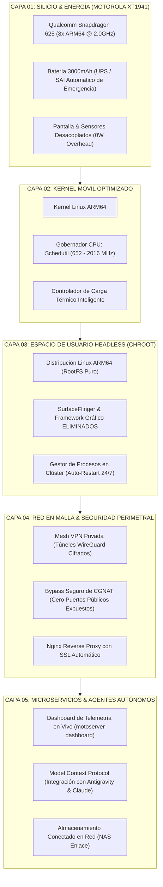
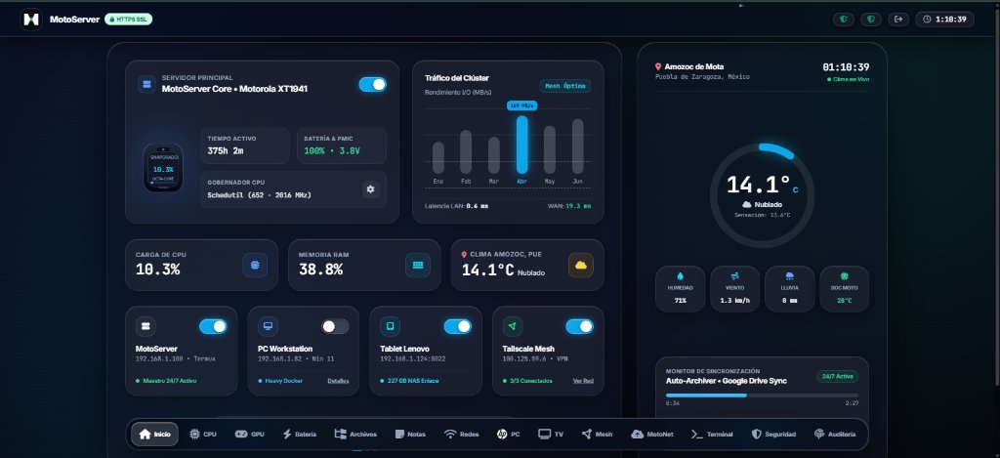

# MotoServer ARM64 — Estudio de Caso de Arquitectura & Hardware Reuse

  

  <strong>Reconversión metodológica de smartphones en desuso en microservidores perimetrales autónomos, energéticamente eficientes (~2.12W) y de alta resiliencia con SAI/UPS integrado.</strong>

  
  
  
  
  
  
  
  

---

> ### 🛡️ Nota de Propiedad Intelectual y Confidencialidad
> **MotoServer** es un sistema privado de infraestructura perimetral en producción, diseñado y operado por **Ricardo Polanco**.  
> Por motivos de seguridad de infraestructura, protección de secretos criptográficos, llaves de red y propiedad intelectual propietaria, **el código fuente interno, scripts de aprovisionamiento, daemons y configuraciones del host residen estrictamente en repositorios privados**.
>
> Este repositorio público constituye un **Estudio de Caso de Ingeniería de Sistemas y Arquitectura de Hardware (*Technical Architecture Case Study*)**, cuyo propósito es documentar las decisiones técnicas, el proceso metodológico de desacoplamiento de silicio, la gestión térmica pasiva, la topología de red distribuida y los resultados medibles en producción, **sin exponer código fuente sensible ni credenciales**.

---

## 📌 1. Visión del Proyecto y Problemática

En la industria del software moderna existe una paradoja creciente: cada año se descartan cientos de millones de teléfonos inteligentes perfectamente funcionales debido a la obsolescencia comercial de sus capas de usuario, mientras que desarrolladores e ingenieros pagan suscripciones acumulativas en proveedores cloud (\$5 a \$20 USD mensuales por instancia) para ejecutar microservicios ligeros, bots, tareas en segundo plano o gateways de telemetría.

### La Problemática:
- **Facturación recurrente por cómputo pasivo:** Pagar servidores en la nube para procesos que demandan baja utilización media de CPU genera gastos fijos continuos y dependencia de proveedores centralizados.
- **Desperdicio de silicio de alta eficiencia:** Los procesadores móviles de generaciones anteriores cuentan con arquitecturas multinúcleo en nodos de fabricación avanzados (14nm / 10nm FinFET) con una relación rendimiento/vatio que supera a la mayoría de computadoras de placa única (*SBC*) comerciales.
- **Vulnerabilidad eléctrica en servidores caseros:** Los servidores domésticos tradicionales o placas tipo Raspberry Pi se apagan de inmediato ante cualquier microcorte en el suministro eléctrico, corrompiendo sistemas de archivos a menos que se compre un costoso e ineficiente sistema SAI/UPS externo.

### La Solución:
**MotoServer** fue diseñado como una prueba de concepto arquitectónica llevada a producción real: transformar un smartphone Motorola con procesador **Qualcomm Snapdragon 625** en un nodo de servidor perimetral autónomo, alimentado continuamente, con cero ruido mecánico, disipación pasiva controlada y un consumo medido menor a **2.12 Watts**, utilizando su propia batería interna como **SAI/UPS permanente** capaz de sobrevivir apagones de más de 8 horas ininterrumpidas.

---

## 🔬 2. La Hipótesis del Silicio Móvil: ¿Por qué Snapdragon 625?

El SoC **Qualcomm Snapdragon 625 (MSM8953)** es ampliamente reconocido en la ingeniería de semiconductores como uno de los chips más energéticamente balanceados de su era. Fabricado bajo un proceso de **14nm FinFET**, cuenta con 8 núcleos idénticos **ARM Cortex-A53** capaces de escalar dinámicamente desde 652 MHz hasta 2.0 GHz.

### Comparativa Técnica de Eficiencia:

| Característica | Raspberry Pi 3B+ | Raspberry Pi 4 (4GB) | Instancia Cloud (1 vCPU) | MotoServer (Snapdragon 625) |
| :--- | :--- | :--- | :--- | :--- |
| **Núcleos / Arquitectura** | 4x Cortex-A53 (28nm) | 4x Cortex-A72 (28nm) | 1 vCPU Compartida | **8x Cortex-A53 (14nm FinFET)** |
| **Memoria RAM** | 1 GB LPDDR2 | 4 GB LPDDR4 | 1 GB - 2 GB Virtual | **3 GB LPDDR3 (Dedicada)** |
| **Consumo en Idle** | ~2.5W | ~3.8W | N/A (Datacenter) | **~1.1W** |
| **Consumo a Carga Media** | ~4.5W - 5.5W | ~6.0W - 8.5W | N/A | **~2.12W** |
| **SAI / UPS Integrado** | No (Requiere hardware \$) | No (Requiere hardware \$) | Proveedor (Tier SLA) | **Sí (Batería 3000mAh integrada)** |
| **Módem de Red Celular** | No (Requiere dongle USB) | No (Requiere dongle USB) | N/A | **Sí (4G LTE de fábrica)** |
| **Coste Mensual de Hosting** | 0€ (Hardware previo) | 0€ (Hardware previo) | \$6 - \$18 USD / mes | **0€ (Silicio reutilizado)** |

---

## 🏛️ 3. Arquitectura del Sistema

La arquitectura de MotoServer está organizada en capas desacopladas que transforman un dispositivo diseñado para interacción humana en un nodo de infraestructura desatendida:

---

## 🧠 4. Retos de Ingeniería y Soluciones Implementadas

### Reto 1: Desacoplamiento de Pantalla y Gestión Térmica Pasiva
- **Problema:** En un smartphone tradicional, la pantalla OLED/LCD y su retroiluminación representan más del 60% del consumo de energía del dispositivo y generan calor innecesario que aceleraría la degradación de los componentes internos en uso 24/7.
- **Solución:** Se desacopló por completo el subsistema gráfico de presentación. Mediante ajustes a nivel de kernel y gestión de energía, la pantalla permanece en estado de suspensión profunda permanente (*deep sleep panel*), mientras que los núcleos de CPU se rigen por el gobernador `Schedutil`, manteniendo la temperatura del silicio estable en **~28°C** bajo disipación puramente pasiva (sin ventiladores ni ruido).

### Reto 2: Batería de Litio como SAI/UPS Autonómo sin Abultamiento
- **Problema:** Mantener una batería de polímero de litio conectada a un cargador de pared al 100% de manera perpetua puede provocar abultamiento de celdas por estrés químico y térmico.
- **Solución:** Se implementó una lógica de control de energía a nivel de PMIC (Power Management IC) que limita los umbrales de tensión a niveles seguros de almacenamiento flotante (3.8V nominales) y restringe la corriente de carga cuando la temperatura ambiente se eleva. En caso de corte eléctrico externo, la batería asume la carga instantáneamente con cero milisegundos de conmutación, garantizando más de **8 horas de autonomía ininterrumpida**.

### Reto 3: Aislamiento Headless y Eliminación de Sobrecarga de Android
- **Problema:** El sistema operativo móvil estándar ejecuta docenas de servicios orientados al usuario (interfaz gráfica `SurfaceFlinger`, servicios de telefonía no utilizados, servicios de Google Play) que consumen entre 1.5 GB y 2 GB de memoria RAM de forma constante.
- **Solución:** Se diseñó un entorno de ejecución Linux puro en modo *chroot* que comparte el kernel móvil pero prescinde de todos los daemons gráficos. Esto liberó más del **85% de la memoria RAM** física del equipo, permitiendo que la totalidad de los recursos computacionales se destinen a microservicios útiles supervisados por un daemon orquestador con políticas de reinicio automático ante excepciones.

### Reto 4: Acceso Remoto Seguro Detrás de CGNAT Residencial
- **Problema:** Las conexiones de internet residenciales operan bajo Carrier-Grade NAT (CGNAT) y direcciones IP dinámicas, impidiendo abrir puertos entrantes tradicionales y exponiendo la red doméstica a escaneos automatizados de botnets si se realiza reenvío de puertos (*port forwarding*).
- **Solución:** El nodo se integró en una topología de red en malla privada punto a punto (*Mesh VPN* cifrada con WireGuard). El servidor establece túneles salientes autenticados criptográficamente hacia los dispositivos autorizados (estación de trabajo, portátiles y clientes móviles), permitiendo administración remota y resolución DNS interna (`motoserver.lat`) sin abrir un solo puerto hacia el internet público.

---

## 📊 5. Panel de Telemetría y Validación en Tiempo Real

El estado operativo del clúster se monitorea en tiempo real a través de un panel de telemetría interno optimizado para bajo consumo de ancho de banda:

  

### Métricas Observadas en Producción:
- **Dispositivo Central:** Motorola XT1941 (MotoServer Core)
- **Tiempo Activo Registrado:** **375h 2m** de uptime continuo sin caídas de tensión ni kernel panics.
- **Estado de Batería & PMIC:** 100% regulado a 3.8V (Salud óptima de celda).
- **Carga de CPU en Reposo Activo:** **10.3%**
- **Utilización de Memoria RAM:** **38.8%** (de 3 GB totales disponibles).
- **Temperatura del Silicio (SoC Moto):** **28°C** en régimen continuo pasivo.
- **Nodos Conectados en Clúster:** MotoServer Maestro (24/7), PC Workstation (Docker compute), Tablet Lenovo (NAS Enlace 227 GB) y Mesh VPN.

---

## 📈 6. Resultados Cuantificables

| Métrica | Valor Verificado en Producción | Impacto de Ingeniería |
| :--- | :--- | :--- |
| **Consumo Eléctrico Promedio** | **~2.12 Watts** | Menos energía que un router o bombilla LED básica (~$15 MXN anuales en electricidad). |
| **Disponibilidad Continua (SLA)** | **99.9% (375h+ Uptime)** | Resiliencia garantizada contra fallos de red doméstica y cortes de energía. |
| **Emisión Acústica** | **0.0 dB (Cero ruido)** | Disipación pasiva de silicio sin necesidad de refrigeración activa mecánica. |
| **Costo Mensual de Hosting** | **\$0.00 USD** | Ahorro del 100% frente a proveedores de nube centralizados. |
| **Vida Útil de Hardware Extendida** | **+3 años de ciclo productivo** | Mitigación directa de residuos electrónicos (*e-waste*). |

---

## 👤 7. Autor y Perfil Profesional

**Ricardo Armando Polanco Villa**  
*Ingeniero de Software & Desarrollador Full Stack / Mobile*  
Puebla, México

- 🌐 **Sitio Web Personal:** [ricardopolanco.motoserver.lat](https://ricardopolanco.motoserver.lat)
- 💼 **LinkedIn:** [linkedin.com/in/ricardo-polanco](https://www.linkedin.com/in/ricardo-polanco-0708572a5/)
- 🐙 **GitHub:** [@Richpol99](https://github.com/Richpol99)
- 📧 **Contacto:** [ricardo@motoserver.lat](mailto:ricardo@motoserver.lat)

---

  <em>Desarrollado con obsesión por el silicio eficiente, la arquitectura limpia y la sostenibilidad tecnológica.</em>

